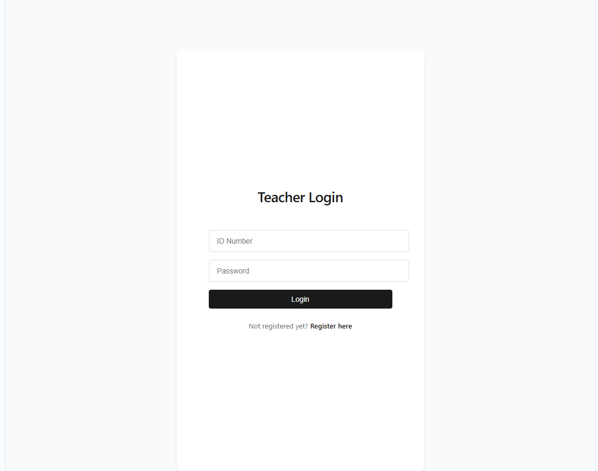
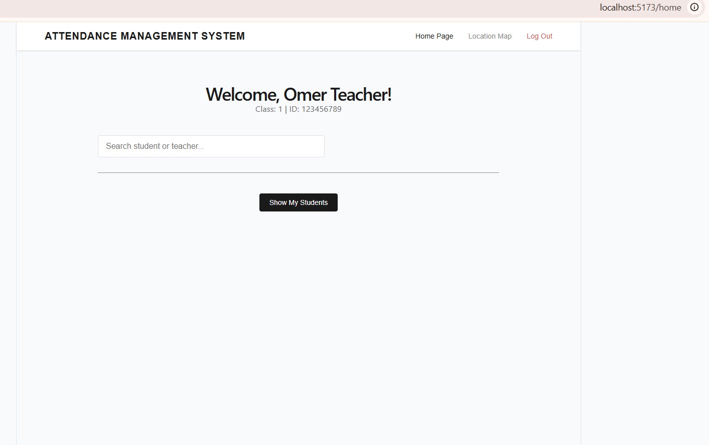
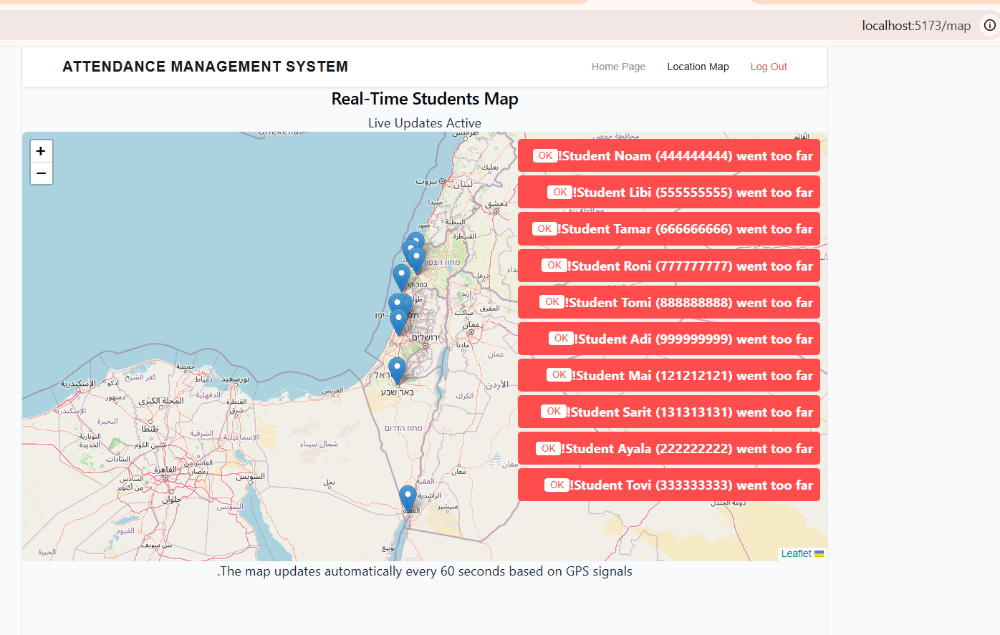
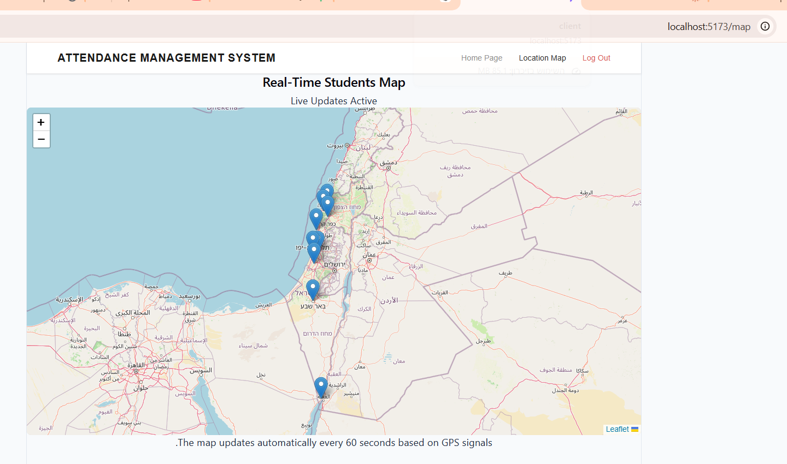
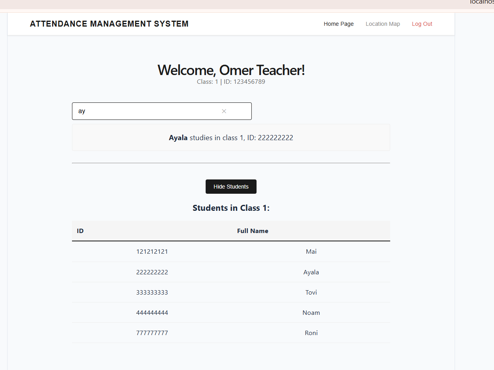

System Overview
The system is a Full-Stack solution designed for real-time monitoring. It consists of three main components:

Backend (Server): Manages business logic, user authentication, and data streaming.

Frontend (Client): Includes a secure registration and login system, and an interactive map to display location data.

GPS Simulator: An independent script that simulates GPS devices and sends location updates to the server every 60 seconds.

Tech Stack
Client Side: Built with React, using Leaflet for maps and Tailwind CSS for styling.

Server Side: Node.js with Express. Real-time communication is handled via SSE (Server-Sent Events).

Database: MySQL relational database.

Security: JWT (JSON Web Tokens) for secure authentication and data protection.

Prerequisites
Before running the project, ensure you have the following installed:

Node.js (Version 16 or higher recommended).

MySQL Server running with the relevant database schema.

Execution Flow
To run the full system, open three separate terminals and run the following commands in this order:

Start the Server:

cd server
npm run dev

Start the Client:
cd client
npm run dev

Start the Simulator:
cd scripts
node simulator.js

Technical Highlights and Assumptions
Real-Time Updates: The system uses SSE to push updates directly from the server to the map, eliminating the need for page refreshing (Polling).

Data Precision: Location data is stored using Degrees, Minutes, and Seconds to maintain high precision within the database.

Security: Access to the real-time data stream is protected by a unique JWT Token for each logged-in teacher.

##images:

תודה רבה !!!
תמר.

